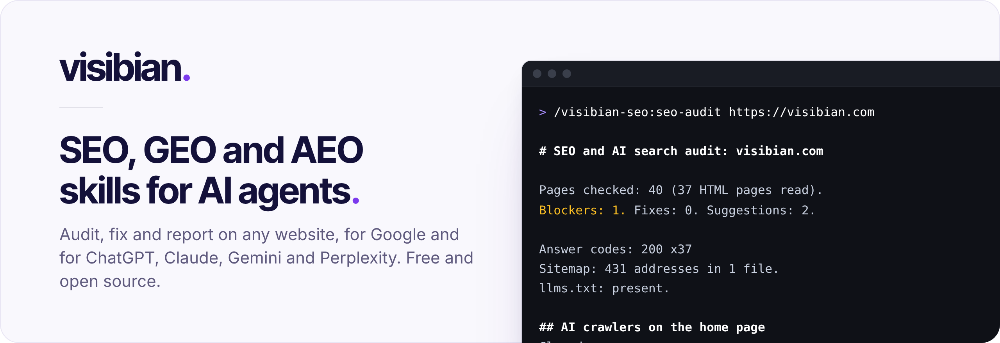

<p align="center">
  <picture>
    <source media="(prefers-color-scheme: dark)" srcset="https://raw.githubusercontent.com/visibian/seo-geo-skills/HEAD/assets/readme/plugins-dark.png">
    
  </picture>
</p>

<h1 align="center">SEO, GEO and AEO skills for Claude and every AI agent</h1>

<p align="center"><a href="LICENSE"></a>  <a href="https://agentskills.io"></a> <a href="https://github.com/visibian/seo-geo-skills/actions/workflows/tests.yml"></a></p>

<p align="center"><a href="#install">Install</a> &nbsp;&middot;&nbsp; <a href="#skills">Skills</a> &nbsp;&middot;&nbsp; <a href="#example">Example</a> &nbsp;&middot;&nbsp; <a href="#faq">FAQ</a> &nbsp;&middot;&nbsp; <a href="https://visibian.com">visibian.com</a></p>

Free, open-source skills that audit and fix a website for search engines and for AI assistants: technical SEO, keyword research from Search Console, on-page optimization, content briefs, internal links, Core Web Vitals, hreflang, local and ecommerce SEO, structured data, client reports, and the work that makes pages readable and quotable in ChatGPT, Claude, Gemini, Perplexity and Google's AI Overviews. They run in Claude Code, claude.ai and Cowork, ChatGPT and Codex, GitHub Copilot, Cursor, Gemini CLI and any client that reads [Agent Skills](https://agentskills.io).

Each check is a small, tested Python script that reports what it observed on your pages, never an invented score, and every statement about how Google or an assistant behaves names its source and the date it was read. Made by [Visibian](https://visibian.com), which measures what AI assistants say about brands.

## Install

In Claude Code:

```text
/plugin marketplace add visibian/seo-geo-skills
/plugin install visibian-seo@visibian
```

Then ask in plain words, or run a skill directly: `/visibian-seo:seo-audit https://example.com`.

<details>
<summary>Other tools</summary>
<br>

| Where | How |
|---|---|
| Claude Code, the Brand Intelligence plugin | `/plugin install visibian-brand-intelligence@visibian`, after the marketplace above |
| claude.ai and Cowork | Customize, Plugins, Add marketplace, with the address https://github.com/visibian/seo-geo-skills, then install |
| ChatGPT and Codex | `codex plugin marketplace add visibian/seo-geo-skills`, then install from the Plugins Directory in the ChatGPT desktop app or Codex |
| GitHub Copilot CLI | `copilot plugin marketplace add visibian/seo-geo-skills`, then `copilot plugin install visibian-seo@visibian` |
| VS Code (Copilot agent plugins) | add `visibian/seo-geo-skills` to the `chat.plugins.marketplaces` setting, then install from Customize in the Chat view |
| Cursor | add this repository as a team marketplace, or copy a folder from `plugins/` to `~/.cursor/plugins/local/` |
| Gemini CLI | `gemini extensions install https://github.com/visibian/seo-geo-skills` (this repository's root is the extension) |
| Kiro, Antigravity, OpenCode, Amp, Goose and other Agent Skills clients | `npx skills add visibian/seo-geo-skills`, or copy the folders under `skills/` into the client's skills folder |

Each folder in `plugins/` carries two manifests: `.claude-plugin/plugin.json` for Claude, and `plugin.json` in the Agent Plugins 1.0 format, which ChatGPT and Codex, GitHub Copilot, VS Code, Cursor and Kiro read. The scripts need Python 3.9 or later and nothing else.

</details>

## What you can ask

| Ask | Skill |
|---|---|
| Run an SEO and AI search audit of example.com | `seo-audit` |
| Here is my Search Console export. Which keywords should I go after? | `keyword-research` |
| Optimize this page for "project management for agencies" | `on-page-seo` |
| Write a content brief for a guide on choosing a CRM | `content-brief` |
| Can ChatGPT, Claude and Perplexity read my site? | `ai-crawler-access`, `ai-search-audit` |
| Make this guide easier for AI Overviews and ChatGPT to quote | `geo-optimization` |
| Why is our Core Web Vitals report failing? | `page-speed` |
| Which of our pages are not indexed, and why? | `search-console` |
| What changed on our site since the last audit? | `seo-monitoring` |
| Which sites link to our competitors but not to us? | `backlink-audit` |
| Check hreflang on our German and French sites | `international-seo` |
| Turn this audit into a report for my client | `seo-report` |

## Skills

`visibian-seo` (Visibian SEO & GEO) holds 24 free skills and needs no account. `visibian-brand-intelligence` holds 8 more that read your own Visibian data.

### SEO

| Skill | What it does |
|---|---|
| [`seo-audit`](https://github.com/visibian/seo-geo-skills/tree/HEAD/skills/seo-audit) | Crawls a site and lists what breaks crawling, indexing and understanding, by priority. |
| [`seo-monitoring`](https://github.com/visibian/seo-geo-skills/tree/HEAD/skills/seo-monitoring) | Compares each crawl with the last and flags pages lost, new noindex and changed canonicals. |
| [`search-console`](https://github.com/visibian/seo-geo-skills/tree/HEAD/skills/search-console) | Pulls Search Console live: queries and pages, index status of each page, sitemap errors. |
| [`keyword-research`](https://github.com/visibian/seo-geo-skills/tree/HEAD/skills/keyword-research) | Finds quick wins, low click-through, questions and topics in your Search Console data. |
| [`backlink-audit`](https://github.com/visibian/seo-geo-skills/tree/HEAD/skills/backlink-audit) | Reads free link exports, checks links live, finds broken pages to reclaim and competitor gaps. |
| [`on-page-seo`](https://github.com/visibian/seo-geo-skills/tree/HEAD/skills/on-page-seo) | Optimizes one page for its query: title, headings, opening, sources, author, links. |
| [`content-brief`](https://github.com/visibian/seo-geo-skills/tree/HEAD/skills/content-brief) | Writes a brief from the pages that already answer the topic, with facts and sources. |
| [`internal-linking`](https://github.com/visibian/seo-geo-skills/tree/HEAD/skills/internal-linking) | Finds orphan, deep and weakly linked pages, and the links worth adding. |
| [`page-speed`](https://github.com/visibian/seo-geo-skills/tree/HEAD/skills/page-speed) | Reads Core Web Vitals and their history from Google and Lighthouse, and turns them into fixes. |
| [`structured-data`](https://github.com/visibian/seo-geo-skills/tree/HEAD/skills/structured-data) | Writes JSON-LD and checks it against Google's required properties. |
| [`international-seo`](https://github.com/visibian/seo-geo-skills/tree/HEAD/skills/international-seo) | Checks hreflang codes, return links and canonicals across language versions. |
| [`local-seo`](https://github.com/visibian/seo-geo-skills/tree/HEAD/skills/local-seo) | Business profiles, consistent addresses, reviews, location pages and LocalBusiness markup. |
| [`ecommerce-seo`](https://github.com/visibian/seo-geo-skills/tree/HEAD/skills/ecommerce-seo) | Product and category pages, Product markup, merchant feeds and faceted navigation. |
| [`seo-report`](https://github.com/visibian/seo-geo-skills/tree/HEAD/skills/seo-report) | Turns an audit into a client-ready, white-label HTML report. |

### AI search: GEO and AEO

| Skill | What it does |
|---|---|
| [`ai-search-audit`](https://github.com/visibian/seo-geo-skills/tree/HEAD/skills/ai-search-audit) | Checks what AI assistants and crawlers can read on your key pages. |
| [`geo-optimization`](https://github.com/visibian/seo-geo-skills/tree/HEAD/skills/geo-optimization) | Makes each section of a page quotable in AI answers, with sources and figures. |
| [`ai-crawler-access`](https://github.com/visibian/seo-geo-skills/tree/HEAD/skills/ai-crawler-access) | Reads robots.txt for 24 AI crawlers and writes the rules you choose. |
| [`llms-txt`](https://github.com/visibian/seo-geo-skills/tree/HEAD/skills/llms-txt) | Writes or checks an llms.txt file, and says what it does not do. |
| [`brand-fact-sheet`](https://github.com/visibian/seo-geo-skills/tree/HEAD/skills/brand-fact-sheet) | Compares the brand's core facts across its own pages. |
| [`answer-first-content`](https://github.com/visibian/seo-geo-skills/tree/HEAD/skills/answer-first-content) | Drafts pages that open with the answer, every claim sourced and dated. |
| [`buyer-questions`](https://github.com/visibian/seo-geo-skills/tree/HEAD/skills/buyer-questions) | Collects the questions buyers ask, from your own data, and maps them to pages. |
| [`comparison-pages`](https://github.com/visibian/seo-geo-skills/tree/HEAD/skills/comparison-pages) | Drafts versus and alternatives pages that keep the rows where the rival is ahead. |
| [`ai-traffic-analytics`](https://github.com/visibian/seo-geo-skills/tree/HEAD/skills/ai-traffic-analytics) | Sets up the Google Analytics, Search Console and Bing reports that count AI traffic. |
| [`brand-in-ai-answers`](https://github.com/visibian/seo-geo-skills/tree/HEAD/skills/brand-in-ai-answers) | Explains what can be known about a brand in AI answers without tracking, and what cannot. |

### Your Visibian data

| Skill | What it does |
|---|---|
| [`connect-visibian`](https://github.com/visibian/seo-geo-skills/tree/HEAD/skills/connect-visibian) | Connects your client to Visibian and fixes connection errors. |
| [`visibility-brief`](https://github.com/visibian/seo-geo-skills/tree/HEAD/skills/visibility-brief) | Writes a weekly or monthly brief against competitors. |
| [`competitor-movement`](https://github.com/visibian/seo-geo-skills/tree/HEAD/skills/competitor-movement) | Shows where competitors gained on you, by assistant, country and topic. |
| [`hallucination-fixes`](https://github.com/visibian/seo-geo-skills/tree/HEAD/skills/hallucination-fixes) | Traces wrong facts in AI answers to their source and plans the correction. |
| [`source-gap-plan`](https://github.com/visibian/seo-geo-skills/tree/HEAD/skills/source-gap-plan) | Finds the pages answers cite where competitors appear and you do not. |
| [`answer-drift-review`](https://github.com/visibian/seo-geo-skills/tree/HEAD/skills/answer-drift-review) | Lists answers that changed, and what changed alongside them. |
| [`ai-traffic-readout`](https://github.com/visibian/seo-geo-skills/tree/HEAD/skills/ai-traffic-readout) | Reads visits and crawler fetches from AI services. |
| [`client-report`](https://github.com/visibian/seo-geo-skills/tree/HEAD/skills/client-report) | Drafts monthly AI visibility reports for agency clients. |

These read a Visibian workspace through its read-only MCP connector at `https://mcp.visibian.com/`, with a token from Settings, API & MCP access (Studio, Growth and Network plans). Claude Code asks for the token when the plugin is enabled (or later: `/plugin configure visibian-brand-intelligence@visibian`), and `connect-visibian` covers the other clients. The connector does not offer OAuth sign-in yet, so claude.ai, Cowork and ChatGPT cannot reach it; the free skills work in all three.

## Example

The `seo-audit` crawler on visibian.com, 17 November 2026, 40 pages (the full report and a client report built from it are in [`examples/`](https://github.com/visibian/seo-geo-skills/tree/HEAD/examples)):

```text
$ python3 scripts/site_audit.py https://visibian.com --max-pages 40 --out seo-audit/

# SEO and AI search audit: visibian.com (2026-11-17)

Pages checked: 40 (37 HTML pages read). Blockers: 1. Fixes: 0. Suggestions: 2.

Answer codes: 200 x37
robots.txt: 200. Sitemap: 431 addresses in 1 file. llms.txt: present.

## Blockers

- Content: 1 page with fewer than 80 words in the HTML before scripts run;
  crawlers and assistants that do not run scripts see little or nothing.
  https://visibian.com/links/
```

## How it differs

Most SEO and GEO skills ask the model to judge a site and give it a score. These skills run scripts that read the pages the way a crawler does and report what is there, so two runs on the same site agree, and the model's work goes into explaining and fixing. Claims about Google, Bing and the AI assistants come from their own documentation or named studies, each with a date, because these systems change month to month. Nothing pretends to measure what assistants say about your brand from a single answer; that takes repeated answers over time, which is what [Visibian Brand Intelligence](https://visibian.com/brand-intelligence.html) does. Your exports, audits and reports stay on your machine.

## FAQ

### What is GEO, and how is it different from SEO?

Generative engine optimization (GEO) is the work of making a site's pages found, understood and cited by AI assistants that answer questions, such as ChatGPT, Perplexity and Google's AI Overviews and AI Mode. Much of it is SEO done well, since several assistants search the web before they answer; the differences are covered in [GEO vs SEO](https://visibian.com/geo-vs-seo.html).

### What is AEO?

Answer engine optimization: the same aim, named after the "answer engines". The skills treat SEO, GEO and AEO as one job with different readers.

### Do the skills work in claude.ai and Cowork, or only in Claude Code?

The skills work in all of them. Scripts need a code environment: Claude Code runs them on your machine, and claude.ai and Cowork run them in their own code environment when it is switched on.

### What is free, and what needs a Visibian account?

The 24 skills of `visibian-seo` are free and MIT-licensed, with no account. The 8 skills of `visibian-brand-intelligence` read data from a Visibian plan with API access.

### What data leaves my machine?

The scripts fetch only the pages and files you point them at, identified as `VisibianSkill/1.0`, and Google's APIs (PageSpeed Insights, Chrome UX Report, Search Console) with your own key or token, which is never printed. Search Console data, link exports, audits and reports stay where they are. Nothing is sent to Visibian.

### Can I use it for client work?

Yes. `seo-report` builds a white-label report with your logo, and the MIT licence allows commercial use.

## Further reading

- [Generative engine optimization, in 7 steps](https://visibian.com/generative-engine-optimization.html)
- [GEO vs SEO](https://visibian.com/geo-vs-seo.html)
- [How to measure your brand's visibility in AI answers](https://visibian.com/measure-ai-search-visibility.html)
- [How to get cited by AI](https://visibian.com/how-to-get-cited-by-ai.html)
- [Should you block GPTBot](https://visibian.com/should-i-block-gptbot.html)
- [The AI crawler directory](https://visibianhq.com/research/crawlers/)

## Contributing

Bug reports, fixes and new checks are welcome; see [CONTRIBUTING.md](https://github.com/visibian/seo-geo-skills/blob/HEAD/CONTRIBUTING.md). Every claim about a search engine or an assistant needs a source and a date, and every script stays on the Python standard library with a test.

## Support and licence

support@visibian.com &nbsp;&middot;&nbsp; [Security](https://github.com/visibian/seo-geo-skills/blob/HEAD/SECURITY.md) &nbsp;&middot;&nbsp; [MIT licence](https://github.com/visibian/seo-geo-skills/blob/HEAD/LICENSE) &nbsp;&middot;&nbsp; [Changelog](https://github.com/visibian/seo-geo-skills/blob/HEAD/CHANGELOG.md)
